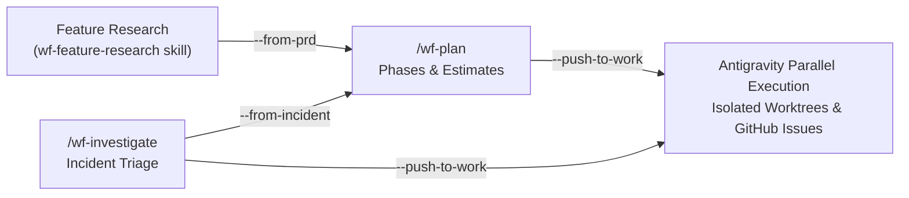

# Workforces

A lean, portable AI toolkit that compiles modernized subagents, modular skills, native lifecycle hooks, and behavioral rules natively across Antigravity, Claude Code, Grok Build, GitHub Copilot, and Cursor.

---

## Workforce vs. Project

When installing this toolkit, you'll choose a **type** that describes the role of the target repository:

### Project (`--type project`)
A **standard codebase** where you're doing the actual work — writing code, shipping features, fixing bugs. Most repos fall into this category (e.g. a web app, API service, or internal tool).

Installing the toolkit into a project repo gives your AI assistant full context about that codebase: its goals, GitHub queue, and team preferences. The `workforces/` workspace folder tracks state and goals *scoped to that project*.

### Workforce (`--type workforce`)
A **central coordinator repo** that tracks and manages multiple project repos. It's not where code gets written — it's the command center. A workforce-type install is appropriate when the repo's purpose is to orchestrate tasks, maintain shared knowledge, or manage cross-project planning across an entire team or product portfolio.

> **In short:** a *project* is where work happens; a *workforce* is what coordinates across many projects.

---

## Toolkit Structure

When installed, `compile_assets.py` separates host-compiled agent assets (the **Toolkit Layer**) from your runtime states and persistent configuration (the **Workspace Layer**):

```
.agents/               ← Toolkit Layer for Antigravity (or .claude/, .grok/, .github/, .cursor/)
├── agents/            ← Host-compiled subagent personas (e.g., wf-project-manager.md / .agent.md)
├── skills/            ← Modular agent skills with semantic discovery (e.g., wf-plan/, wf-clean-coder/)
├── rules/             ← Behavioral rules (instructions/*.instructions.md on Copilot, *.mdc on Cursor)
├── plugins/           ← Domain plugin & lifecycle hook bundles (or .claude/settings.json / .grok/hooks.json)
└── teams/             ← Installed modular Team Pack manifests

workforces/            ← Workspace Layer (user-owned configuration and state)
├── config.json        ← Persistent multi-host install config (hosts, auto_detect_hosts, installed_teams)
├── .manifest.json     ← Compiled file manifest for safe updates and reference-counted pruning
├── README.md          ← Workspace overview
├── workrules.md       ← User configurations, settings, and response preferences
├── workstate.md       ← Workspace tracking state
├── goals/             ← RICE-scored blueprints and goals
└── team-sync/         ← YYYY-MM-DD.md files documenting standups and syncs
```

---

## Installation Guide

### For AI Assistants (Autopilot Install)
If you are an AI assistant (Antigravity/Gemini, Claude Code, GitHub Copilot, Cursor, or Grok Build) tasked with installing this repo:
1. Clone this repository to `/tmp/workforces`.
2. Auto-detect present workspace AI hosts (or specify single/comma-separated hosts) and run:
   ```bash
   bash /tmp/workforces/skills/wf-management/scripts/setup.sh ./ --hosts <auto|all|csv> --type <repo-type> --non-interactive
   ```
   *Supported host IDs (`--hosts` or `--editor` alias): `antigravity` (`gemini`), `claude` (`claude-code`), `copilot` (`vscode`, `github`), `cursor`, `grok` (`grok-build`), `auto`, or `all`. On a first Grok install without existing `.grok/{agents,skills,rules,commands}`, pass `--hosts grok` explicitly ([docs/grok.md](docs/grok.md)).*
3. Configure the user's response preferences inside `workforces/workrules.md` under `## AI Preferences`.

### For Humans (Manual Install)
```bash
git clone https://github.com/wedigcode/workforces.git /tmp/workforces
bash /tmp/workforces/skills/wf-management/scripts/setup.sh ./
rm -rf /tmp/workforces
```
For multi-host options, compiler details, and `workforces/config.json` configuration, see the [Setup Guide](docs/setup.md).

---

## Core Components

### Skills
| Skill | Description |
|-------|-------------|
| [`wf-code-graph`](skills/wf-code-graph/SKILL.md) | Zero-dependency symbol indexer, function call graph mapper, and pre-hook impact analyzer |
| [`wf-post-code-review`](skills/wf-post-code-review/SKILL.md) | Whole-codebase post-hook quality reviewer and blast-radius evaluator |
| [`wf-site-setup`](skills/wf-site-setup/SKILL.md) | Greenfield site initialization, multi-team handoffs, scaffolding safeguards, and brief generation |
| [`wf-ai-search-optimization`](skills/wf-ai-search-optimization/SKILL.md) | Framework-aware GEO readiness: llms.txt, robots.txt, ai.txt, ai-plugin.json, and sitemaps |
| [`wf-image-workflow`](skills/wf-image-workflow/SKILL.md) | Image planning queue in `workforces/images.json`, Antigravity `generate_image`, and optimization |
| [`wf-memory-management`](skills/wf-memory-management/SKILL.md) | Protocol for navigating OKF catalogs and managing workspace memories |
| [`wf-github-project-planning`](skills/wf-github-project-planning/SKILL.md) | Create/update GitHub issues and interact with Project V2 boards |
| [`wf-management`](skills/wf-management/SKILL.md) | Update, patch, and align settings for the Workforces toolkit |
| [`wf-business-frameworks`](skills/wf-business-frameworks/SKILL.md) | Contemporary MBA strategy frameworks, Value Stick, JTBD, Growth Loops, and SaaS unit economics |
| [`wf-feature-research`](skills/wf-feature-research/SKILL.md) | Research-first pipeline: gap analysis, PRD, and work breakdown across projects |
| [`wf-usage-tracker`](skills/wf-usage-tracker/SKILL.md) | On-demand and historical token, character, thought, and subagent usage tracking across agent sessions |

### Agents & Team Roster
Full roster documentation available in [`docs/teams-and-agents.md`](docs/teams-and-agents.md).

| Agent Tag | Role / Domain | Core Capabilities |
| :--- | :--- | :--- |
| [`@wf-project-manager`](agents/wf-project-manager.md) | Project Manager | Backlog prioritization, Value Stick scoring, SaaS unit economics, and GitHub sync |
| [`@wf-programmer`](agents/wf-programmer.md) | Software Engineer | Clean code authoring, TDD, symbol graph index lookup, and post-edit reviews |
| [`@wf-designer`](agents/wf-designer.md) | Visual & UI/UX Designer | Visual concept ideation, design tokens, layout specifications, and design QA reviews |
| [`@wf-marketer`](agents/wf-marketer.md) | Marketer | JTBD positioning, Connected Strategy models, PAS copywriting, and closed growth loops |
| [`@wf-sales`](agents/wf-sales.md) | Sales Specialist | Prospect research, JTBD discovery, Customer Delight ROI framing, and closing |
| [`@wf-social`](agents/wf-social.md) | Social Engager | Content discovery, cold-post triage, and high-engagement reply catalysts |
| [`@wf-growth`](agents/wf-growth.md) | Growth & SEO Lead | Intent matching, programmatic SEO, closed growth loops, and platform network effects |
| [`@wf-operations`](agents/wf-operations.md) | Operations Lead | Metrics dashboards, telemetry tracking, sprint velocity, and workforce state |
| [`@wf-researcher`](agents/wf-researcher.md) | Feature Researcher | Gap analysis, competitive teardowns, and structured PRD specifications |
| [`@wf-scribe`](agents/wf-scribe.md) | Scribe | Zero-narrative session context recording and architectural persistence |
| [`@wf-launcher`](agents/wf-launcher.md) | Launch Specialist | High-velocity pre-sales, concierge MVPs, painted doors, Stripe rails, and sprints to first dollar (TTFD) |
| [`@wf-unbundler`](agents/wf-unbundler.md) | Micro-SaaS Architect | Incumbent software unbundling, single-feature micro-SaaS opportunities, and zero-bloat PRDs |
| [`@wf-disruptor`](agents/wf-disruptor.md) | Disruption Scout | Million-dollar market gaps, macro consulting trend synthesis (McKinsey/BCG/Bain), and lean validation tests |

### Interactive Slash Commands (`/wf-*`)
Every Workforces skill and agent uses the `wf-` prefix (`@wf-<agent>`, `/wf-<skill>`) to simplify discovery and avoid name collisions. Core interactive command-center entrypoints include:

| Slash Command | Skill Directory | Description |
|---|---|---|
| `/wf-sync` | [`wf-sync`](skills/wf-sync/SKILL.md) | Multi-mode sync: daily standup (`--daily`), strategy review (`--strategy`), goals (`--goals`), & personal radar (`--me`) |
| `/wf-plan` | [`wf-plan`](skills/wf-plan/SKILL.md) | Phased project planning, RICE scoring, task breakdown, estimates, and execution topology selection |
| `/wf-dashboard` | [`wf-dashboard`](skills/wf-dashboard/SKILL.md) | Launch the Workforce Studio & Daily Standup Cockpit Dashboard |
| `/wf-advisor` | [`wf-advisor`](skills/wf-advisor/SKILL.md) | Strategic advisory, consultative problem discovery & trade-off evaluation |
| `/wf-ideate` | [`wf-ideate`](skills/wf-ideate/SKILL.md) | Rapid ideation, atomic micro-SaaS unbundling, and market disruption exploration |
| `/wf-investigate` | [`wf-investigate`](skills/wf-investigate/SKILL.md) | Incident triage, log streaming to scratch, postmortem generation |
| `/wf-question-formulation` | [`wf-question-formulation`](skills/wf-question-formulation/SKILL.md) | Formulate high-leverage questions with trade-offs before escalating decisions |
| `/wf-update` | [`wf-update`](skills/wf-update/SKILL.md) | Recompile active AI host installations, prune obsolete assets/hooks, and manage Team Packs |

### Modular Domain & Agent Skills
Specialist capabilities invoked via `/wf-<skill>`, `@wf-<agent>`, coordinators, or natural prompts:

| Skill | Directory | Description & Invocation |
|---|---|---|
| **Codebase Improvement** | [`wf-codebase-improvement`](skills/wf-codebase-improvement/SKILL.md) | 5-pillar code quality audit & hygiene (`/wf-codebase-improvement` or prompt) |
| **Site Setup** | [`wf-site-setup`](skills/wf-site-setup/SKILL.md) | Greenfield site setup & Product Brief pipeline (`/wf-site-setup` or prompt) |
| **Feature Research** | [`wf-feature-research`](skills/wf-feature-research/SKILL.md) | Multi-phase scoping, gap analysis, and PRD generation (`/wf-feature-research` or prompt) |
| **Clean Coder & Graph** | [`wf-clean-coder`](skills/wf-clean-coder/SKILL.md) · [`wf-code-graph`](skills/wf-code-graph/SKILL.md) | TDD mindset, symbol lookup, deduplication, and AST call graphs |
| **Brand Guidelines** | [`wf-brand-guidelines`](skills/wf-brand-guidelines/SKILL.md) | Brand voice, palette, typography, and `docs/brand-context.md` |
| **Launch & Validation** | [`wf-launch-playbook`](skills/wf-launch-playbook/SKILL.md) · [`wf-market-validation`](skills/wf-market-validation/SKILL.md) | Pre-sale painted doors, TTFD/TTOU metrics, and rapid pretotyping |
| **Task & Issue Tracking** | [`wf-task-tracker`](skills/wf-task-tracker/SKILL.md) · [`wf-issue-tracker`](skills/wf-issue-tracker/SKILL.md) | Deferred task capture, lifecycle tracking, and session lineage |
| **Session Context** | [`wf-session-context`](skills/wf-session-context/SKILL.md) | Cross-session context preservation and zero-narrative scribe persistence |
| **Social Engagement** | [`wf-social-engagement`](skills/wf-social-engagement/SKILL.md) | Anti-bot community engagement, cold-post triage, and action dashboard |
| **Integrity Validator** | [`wf-integrity-validator`](skills/wf-integrity-validator/SKILL.md) | Reference lineage enforcement and link verification (`validate-references.py`) |
| **Workforce Canvas** | [`wf-canvas`](skills/wf-canvas/SKILL.md) | Interactive node-based visual command canvas daemon (`server.py`) |
| **Workforce Management** | [`wf-management`](skills/wf-management/SKILL.md) | Multi-AI frontmatter compilation, updates, team packs, and reference-counted pruning |

### Multi-AI Compiler & Native Lifecycle Hooks
`compile_assets.py` combines canonical sidecar JSON (`agents/*.json`, `rules/*.json`, `skills/*/skill.json`, `plugins/*/plugin.json`) with declarative host adapter profiles (`config/hosts/*.json`) to emit native frontmatter, extensions (`.agent.md`, `.instructions.md`, `.prompt.md`, `.mdc`), rewritten relative links, and lifecycle hooks per host:
- **`PreToolUse` & `PostToolUse` Quality Gates**: Triggers `wf-code-graph` symbol verification prior to file edits and runs `post_code_reviewer.py` / `validate-references.py` after edits.
- **Native Per-Host Hook Emission**: Emits `.agents/plugins/<name>/{plugin.json,hooks.json}` for Antigravity, idempotently merges/prunes `wf-*` hook commands in `.claude/settings.json` for Claude Code, compiles `.grok/hooks.json` + `.grok/plugins/<name>/` for Grok Build, and skips unsupported JSON PreToolUse hooks cleanly on GitHub Copilot and Cursor.

---

## Integrated Skill Pipeline

The toolkit connects feature research, planning, incident triage, and execution into a cohesive, hands-off pipeline:



### End-to-End Skill Lifecycles

1. **Feature Scoping ➔ Planning ➔ Execution**
   - **Research & Spec**: Run feature research (`wf-feature-research` skill) to run gap analysis and output a PRD (`docs/prd-*.md`).
   - **Phase & Estimate**: Run `/wf-plan --from-prd docs/prd-feature.md` to split the PRD into deployable phases, tasks, and time estimates.
   - **Push to Execution**: Use the `--push-to-work` flag (or accept the prompt) to sync Phase 1 tasks into `workforces/workstate.md` and create tracked GitHub issues.
   - **Execute**: Run parallel subagents via `wf-agent-parallelization` (isolated worktrees in `.worktrees/<slug>`) or review active tasks via `/wf-sync`.

2. **Incident Triage ➔ Remediation**
   - **Triage & Diagnose**: Run `/wf-investigate [service-name]` to stream logs into workspace scratch space (`workforces/tmp/`), classify root cause, and generate a postmortem (`workforces/incidents/`).
   - **Remediate**: Pass `--push-to-work` to push P0/P1 fixes into your active tasks, or run `/wf-plan --from-incident` to build a full remediation plan.

---

## Updating

Update all active/detected AI host folders (`workforces/config.json`) using the built-in updater script or `/wf-update`:

```bash
# Preview multi-host modifications
bash .agents/skills/wf-management/scripts/update.sh ./ --dry

# Apply updates across all active/detected hosts (or pass --hosts claude,copilot,cursor)
bash .agents/skills/wf-management/scripts/update.sh ./
```

> **Upgrading from a pre-`wf-` install (`workforce-management`) or legacy `.github/copilot/`:** Run `/wf-update` (which automatically bootstraps from upstream if `wf-management` is missing and migrates legacy paths) or run once from a temporary clone (`tmp_wf="$(mktemp -d)" && git clone --depth=1 https://github.com/wedigcode/workforces.git "$tmp_wf" && bash "$tmp_wf/skills/wf-management/scripts/update.sh" ./ --force && rm -rf "$tmp_wf"`).

Or ask your AI assistant: *"Update the workforces toolkit"* or run `/wf-update`.

